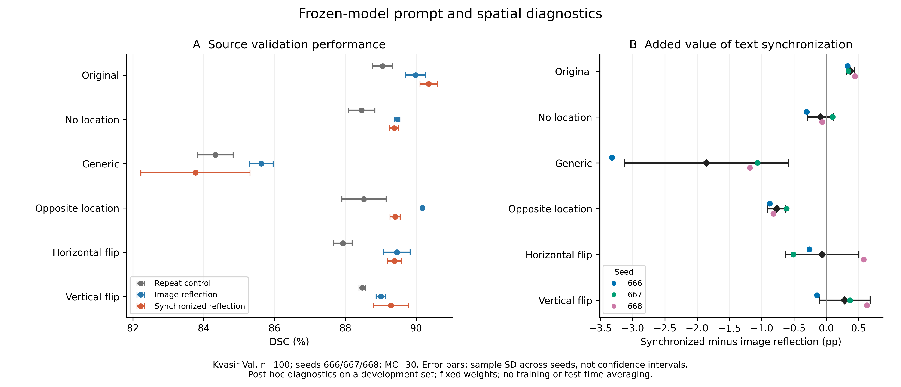
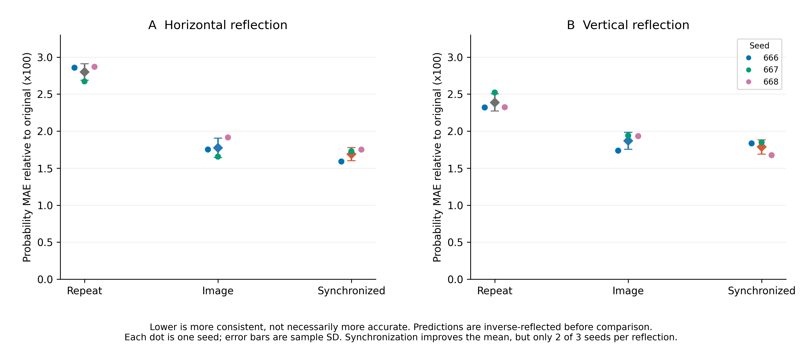

# 54项提示与空间诊断验收报告

本轮实验执行与数据验收通过，但没有通过上一阶段设定的继续推进同步镜像核心创新的研究门槛。建议结束将图文同步镜像作为论文主要创新的路线，保留仅图像增强作为后续基线。MedCLIPSeg研究可以继续；下一条方法路线需要重新明确问题、设计公平对照。

## 实验完成与验收范围

- 完成时间：2026-10-03 11:57:36，香港时间；首项开始于11:17:19，墙钟耗时40.29分钟，有效任务用时39.34分钟。
- 9个固定最终权重 × 6种条件，共54项，全部completed，无失败；每项100张源域Kvasir Val，MC=30，batch=32。
- 验收重新读取并复算5,400份预测的DSC、NSD、前景精确率/召回、失败统计、小目标与概率变化指标，校验10,908份结果文件的SHA256。
- 原代码、数据、初始化权重、九个最终权重、诊断代码及900份原始概率参考重新通过协议锁定校验。900份original预测和306份未改写方向的opposite预测与原参考对齐；最大概率绝对差为0，阈值后二值结果完全一致。
- Val共100份唯一图像文件，全部有前景；小目标25张，阈值保持源域Train前景面积第25百分位0.058989688326573426。
- 概率、方差、熵数组均完整、有限，PNG与概率阈值一致；熵由均值复算。验收未重新运行MC前向，因此没有从原始30次抽样重建方差。
- 错误日志只有timm导入路径弃用提示，无运行异常。未启动新增训练，未修改正式测试主表。

## 三种子总体结果

单位为DSC百分数；括号中为同步减仅图像增强的百分点差值。重复输入对照是预算匹配对照，不是未经修改的官方基线。

|条件|重复输入对照|仅图像增强|图文同步增强|同步额外贡献 pp|
|---|---:|---:|---:|---:|
|原图原提示|89.0512|89.9870|90.3593|+0.3723|
|删除位置|88.4609|89.4675|89.3778|-0.0897|
|固定通用提示|84.3286|85.6257|83.7709|-1.8548|
|错误位置|88.5273|90.1754|89.4058|-0.7696|
|水平同步镜像|87.9291|89.4562|89.3921|-0.0641|
|垂直同步镜像|88.4781|89.0022|89.2867|+0.2845|

原提示下同步模型在Val的平均优势为+0.3723pp，但这个Val已经用于反复开发，不能用它覆盖正式五域Test里附加效应很小的结果。完整正式结果见[前一阶段总报告](../final_research_review_20261003/总报告_研究总结与发表可行性.md)。

## 删除或扰乱提示后同步优势消失

|条件|seed666差值 pp|seed667差值 pp|seed668差值 pp|相对原提示优势变化 pp|
|---|---:|---:|---:|---:|
|原图原提示|+0.3303|+0.3423|+0.4443|+0.0000|
|删除位置|-0.3027|+0.0991|-0.0655|-0.4620|
|固定通用提示|-3.3177|-1.0650|-1.1816|-2.2271|
|错误位置|-0.8762|-0.6147|-0.8179|-1.1419|
|水平同步镜像|-0.2618|-0.5089|+0.5783|-0.4364|
|垂直同步镜像|-0.1434|+0.3687|+0.6281|-0.0878|

固定通用提示下，同步模型三个种子均低于仅图像增强，平均低1.8548pp；同步模型从原提示90.3593降至83.7709，下降6.5884pp，仅图像模型下降4.3613pp。错误位置下同步模型三个种子也均更差，平均低0.7696pp。
按每张图像先对三个种子的配对DSC差值取均值，通用提示下同步模型在75/100张图像上下降、25张提高；错误位置下62张下降、38张提高。通用提示的劣化并非仅由一两张样本造成。这仍是开发集的描述性分析，不能将图像视为独立患者。
这支持一个范围明确的结论：在当前固定权重和Val上，同步训练模型对属性提示尤其是位置干预更敏感。它不证明模型内部注意力已经采用某种特定机制，也不代表任何文本信息都无用。
对错误描述更敏感本身不一定是模型缺陷，也可能说明模型更充分地使用了文字。当前问题是，这种敏感性没有同时带来已确认的额外测试收益或稳定的空间鲁棒性，所以不足以构成所期待的正向方法证据。
在66张实际含方向词的图像中，错误位置使同步模型相对自己的原提示下降1.4447pp，而仅图像增强变化为+0.2855pp。其余34张center-only图像文本不变，已独立核验预测不变，不能算成受到错误方向干预的样本。
位置错误时，同步模型的像素总体精确率在三个种子都低于仅图像增强；同步减仅图像分别为−1.3280、−2.3696、−2.4863pp。这与没有取得可靠空间鲁棒性收益的判断一致。

## 镜像一致性略有改善但未形成稳定精度收益

水平反变换后的概率MAE，三种子均值从0.017740降至0.016896；垂直从0.018698降至0.017866。数值越小代表与原图预测越一致，但不代表更接近GT。水平和垂直均只有2/3种子改善。
水平同步镜像下，额外DSC均值为−0.0641pp，只有1/3种子提高；垂直为+0.2845pp，只有2/3种子提高。垂直优势还小于原提示下+0.3723pp，因此不能把垂直结果单独挑出作为鲁棒性成功证据。
逐图取三种子配对差值均值后，水平有40张提高、59张下降、1张持平；垂直49张提高、50张下降、1张持平。垂直配对差值中位数为−0.0117pp，均值的正值并不代表多数图像改善。
小目标结果同样不稳定：水平条件下同步额外收益均值+0.6957pp但仅2/3种子为正；垂直仅+0.0143pp且仅1/3为正。不能据此声称解决小目标或漏检问题。

## 研究决策与后续边界

上一阶段约定的继续条件是：附加价值跨种子可重复、覆盖多张图像，并且绝对分割和机制指标能形成一致解释。本轮没有满足这一组合条件。建议停止为同步镜像本身继续增加长训练或叠加模块。
当前可以写成完整的复现、消融与限制分析；对于以模型改进为核心的三至四区投稿目标，核心贡献仍未建立。本轮增加了可靠的负面证据，不应改写为方法成功。
若继续MedCLIPSeg方向，优先提出一个新的、可检验的问题：能否在推理只提供固定类别提示时，保留属性提示训练的收益。第一步应是用同一数据、同一预算、相同初始化，重新训练固定类别提示的公平基线，再决定是否值得设计文本可信度或训练期属性迁移模块。本轮generic只是给既有权重换输入，不能代替该基线；也没有验证这些新模块。
当前代码和全部旧权重保留。用户随后已选择seed666三组各30轮，并授权检查通过后直接启动；新阶段以固定通用提示部署为共同评价条件，操作与状态见[提示训练筛选说明](../../README_提示训练筛选.md)。

## 解释限制

1. 六条件是在已用于方法开发的Val上做固定权重事后诊断，不是新的独立确认。全部54项只有100张共同图像，5,400条记录不是5,400名患者。
2. 原属性提示可能来自GT标注；删除位置仍保留其他逐图属性。通用提示固定为a polyp in a colonoscopy image，模型训练时仍见过属性提示。
通用提示同时改变了属性信息量和句式分布；本轮不能将成绩下降全部归因于依赖GT属性，也不能排除训练与推理提示分布变化的影响。
3. 本报告均值及离散程度以三个训练种子为单位，图中误差条为样本标准差，不是置信区间。没有根据这些诊断选择正式Test的提示或阈值。
4. Val没有无病灶样本，只能分析前景图像中的背景误分，不能估计无病灶人群假阳性。

## 可复用文件

- [验收证据](audit.json)、[逐项核验日志](audit.log)、[可重跑验收脚本](audit.py)。
- [三种子汇总表](diagnostic_summary.csv)、[逐种子配对差值](paired_contrasts.csv)、[分组与逐图分布分析](analysis.json)。
- [总体结果与同步贡献图](fig01_diagnostic_DSC.pdf)、[镜像一致性图](fig02_reflection_consistency.pdf)，均另存300dpi PNG与SVG。
- [原始自动报告](../../MedCLIPSeg/outputs_research/validation_kvasir_v1/diagnostic_report.md)。

